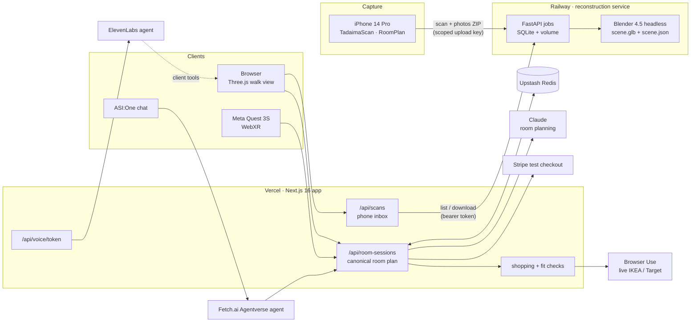
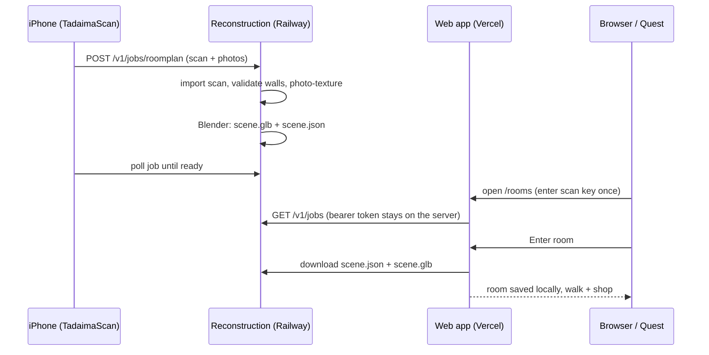

# tadaima

**Scan your room with an iPhone, walk through it in the browser or a Meta Quest, and shop for furniture that actually fits.**

Live: **[tadaima.devshardat.work](https://tadaima.devshardat.work)** · LA Hacks 2026

tadaima (ただいま, "I'm home") turns a real room into a measured 3D space you can furnish. Every piece you try is checked against the room's actual walls, doors and existing furniture before it can go in your basket.

## What it does

- **Scan.** The TadaimaScan iPhone app (SwiftUI + RoomPlan) captures walls, openings and furniture, plus calibrated photos, and uploads them in one tap.
- **Rebuild.** A FastAPI service runs our reconstruction pipeline and Blender 4.5 headless. It turns the scan into a validated room plan and a photo-textured GLB.
- **Walk and furnish.** The room opens in the browser in walk or dollhouse view. Browse a saved IKEA/Target catalog or search live with Browser Use. Every result is fit-checked against the room's geometry before you can place it.
- **Talk to it.** An ElevenLabs voice agent, backed by Claude for planning, finds, previews, moves and swaps furniture through the same validated room operations as the UI.
- **Step inside.** On Meta Quest, Enter VR puts you in the room at real scale. The website's own UI floats beside you, and you hold A/X to talk.
- **Check out.** The basket goes through Stripe (test mode). An ASI:One agent on Fetch.ai's Agentverse can edit the same room from chat.

## Architecture



### Phone scan to room



The phone uploads straight to the reconstruction service because scan bundles are larger than Vercel's 4.5 MB request limit. Its upload key can only submit scans and check their status. The web server holds the full service token, and browsers never see it.

## Repository

| Folder | Owner | What lives there |
| --- | --- | --- |
| [`backend/`](backend/README.md) | Matthew | Contracts, room plan store, shopping, checkout, voice, Fetch.ai agent |
| [`reconstruction/`](reconstruction/README.md) | Stephen (lead) | Scan import, room geometry, Blender exports, [reconstruction service](reconstruction/service/README.md), iPhone app |
| [`frontend/`](frontend/README.md) | Angelina | Screens, onboarding, responsive UI, products and basket |
| [`spatial/`](spatial/README.md) | Silas | Three.js room, placement, Quest/WebXR, VR menu |

`app/` holds thin Next.js routes and `public/` holds shared assets. Design notes, research and sponsor alignment are in [docs/](docs/README.md).

## Run it locally

```bash
npm install
npm run dev                     # http://localhost:3000
```

Put keys in `.env.local` (never commit it). Without keys the app still runs: room sessions fall back to memory, and the saved catalog works offline.

| Variable | Enables |
| --- | --- |
| `KV_REST_API_URL`, `KV_REST_API_TOKEN` | Upstash Redis room sessions (required in production) |
| `ELEVENLABS_API_KEY`, `ELEVENLABS_AGENT_ID` | Voice agent |
| `ANTHROPIC_API_KEY` | Room planning |
| `BROWSER_USE_API_KEY` | Live store search |
| `STRIPE_SECRET_KEY`, `NEXT_PUBLIC_STRIPE_PUBLISHABLE_KEY` | Test checkout |
| `TADAIMA_SERVICE_URL`, `TADAIMA_SERVICE_TOKEN`, `TADAIMA_SCAN_UPLOAD_KEY` | Phone scans via the reconstruction service |

**Phone scan → room on one Mac:** `reconstruction/service/demo.sh` starts the reconstruction service and the web app together and prints the phone settings. See the [service README](reconstruction/service/README.md).

**Meta Quest:** open the live site in Quest Browser and choose a room, then **Enter VR**. For local dev, run `adb reverse tcp:3000 tcp:3000` and open `localhost:3000`. See [Quest setup](docs/quest-setup.md).

## Tests

```bash
npm run test:spatial            # room, placement, WebXR and VR menu
npm test                        # backend contracts, sessions, checkout
python3 -m unittest discover -s reconstruction/tests   # reconstruction + service
```

## Notes

- Scan geometry is a draft. Check sizes before buying.
- Checkout runs in Stripe test mode, and no real orders are placed.
- The homepage hero references `/art/japan.mp4`, which is excluded from git. Supply a licensed clip before shipping it.
- Paper Mono is bundled under the [OFL](app/fonts/PaperMono-OFL.txt).
