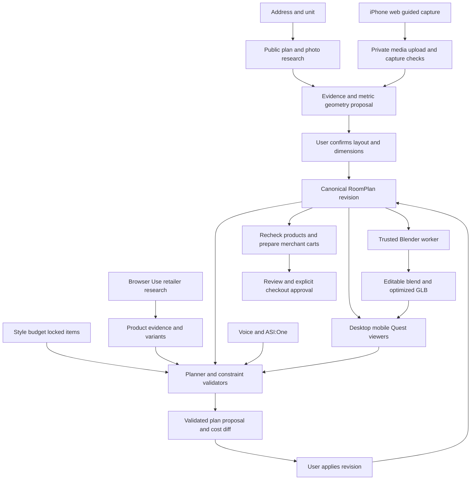

# Proposed system architecture

**Status:** Recommended architecture, not the current implementation. The repository currently has a client-rendered Three.js landing hero and no application backend. The choice of database, storage, queue, authentication, deployment platform, and reconstruction/model providers remains open.

## One shared plan, several interfaces

The backend owns a canonical, versioned `RoomPlan`. Desktop, iPhone, Quest, ElevenLabs tools, and the Fetch agent all read and mutate that plan through the same validated operations. Viewers render a plan; they do not independently invent geometry, product prices, or payment state.

Paper belongs in the design workflow, not in this runtime graph. A selected Solana feature would have a separate wallet/escrow boundary; it must not be implied by ordinary cart preparation.

## Services and responsibilities

| Component | Owns | Must not assume |
| --- | --- | --- |
| Next.js web application | Onboarding, review screens, shared viewer, touch controls, job progress | All browsers support XR, microphone, or the same camera codecs |
| Application API | Authorization, schema validation, plan revisions, tool execution, job lifecycle | LLM output is trusted state |
| Evidence store | Source URLs, retrieval time, observations, dimension provenance | A search result or extracted JSON is verified truth |
| Capture pipeline | Uploads, frame selection, reconstruction proposals, measurement requests | RGB video contains native tracking poses or exact scale |
| Blender worker | Deterministic scene construction, export, asset validation | It should execute arbitrary model-generated Python |
| Product research worker | Browser Use tasks, structured candidates, rechecks, cart evidence | Merchant sessions or carts are interchangeable |
| Planner and validators | Constraint-aware proposals, item placement, cost calculations, diffs | The language model alone proves geometric feasibility |
| ElevenLabs adapter | Speech input/output and approved application tool calls | Spoken success means an action succeeded |
| Fetch adapter | ACP/ASI:One conversations using the same application operations | Linking to the web app completes the required chat workflow |
| Optional Solana adapter | Selected, separately specified on-chain operation | A transfer settles a retailer order |

For the hackathon, these can be modules in one backend plus one worker process. Separate services are not necessary just because the diagram has multiple responsibilities. Long-running reconstruction and browser jobs should not depend on a single open HTTP request staying alive.

## Input to reconstruction

1. Create a project and a capture/research job.
2. Address input produces candidate plan sources with explicit exact-unit/model/building/unknown scope. Capture input produces private media and quality observations.
3. Propose geometry with evidence attached to important measurements. Keep conflicting evidence visible.
4. Ask the user to confirm the layout, mirrored orientation, known wall measurements, openings, and existing furniture to keep.
5. Save the confirmed geometry revision before generating the scene. Unconfirmed dimensions may still be previewed, but must remain visibly inferred.
6. Generate the shell with a controlled Blender script from structured input. Save the source plan, `.blend`, and GLB, each linked to its input revision and generator version.

The GLB is a rendering artifact, not the authoritative data store. A reference scan or dense reconstruction may contain existing furniture and visual noise; keep it separate from editable walls, openings, fixed fixtures, and movable furniture.

## Planning and shopping loop

The planner receives the current plan revision, selected item ID, user intent, hard constraints, soft preferences, and product candidates. It proposes a new revision. Deterministic checks verify geometry, locked-item preservation, dimensional units, known cost arithmetic, budget limits, and evidence completeness. The user sees the change and applies it.

Separate hard constraints from preferences. “Keep this desk” is not a styling suggestion. If constraints conflict, return the smallest actionable conflict, such as insufficient available width, instead of silently removing an item or scaling it down.

Product availability and commercial facts are observations with timestamps. On cart preparation, recheck variants, dimensions, listed price, availability, delivery location assumptions, tax/shipping visibility, and merchant cart state. A newly changed fact produces a new review; it does not silently inherit an old approval.

## Proposed command envelope

Every mutating command should carry `projectId`, `expectedRevision`, `requestId`, and an authenticated actor. Commands that refer to an object use its stable ID. A selected object must be resolved before a vague voice command such as “replace that.”

Recommended operations:

- `createProject`, `startAddressResearch`, `startCaptureProcessing`.
- `confirmGeometry`, `setConstraints`, `proposePlanChange`, `applyPlanChange`.
- `researchProducts`, `recheckProducts`, `prepareMerchantCarts`.
- `getProject`, `getJob`, `getPlanDiff`, `getCartReview`.

These are conceptual operation names, not existing routes or SDK APIs. HTTP, server actions, worker messaging, and persistence choices should follow the eventual implementation. Keep the tool interface small rather than exposing arbitrary filesystem, browser, payment, or database operations to an agent.

## Revisions and concurrency

- Increment a server-owned revision on accepted state changes. Reject stale writes with a conflict that includes the current revision.
- Replanning creates a proposal referencing a base revision; applying it validates the base again.
- Broadcast applied state via a chosen subscription mechanism or polling. Do not let each viewer run a competing local planner.
- Device selection and camera position can be local UI state. Shared item placement, constraints, and cart approvals belong in canonical state.
- A Quest spatial anchor or calibration transform is device/session-specific. Shared model coordinates do not align the model with a physical room automatically.
- If an async result arrives after a newer plan exists, mark it stale or rebase explicitly. Do not overwrite a newer accepted plan.

## Job lifecycle and recovery

Recommended states: `queued`, `running`, `needs_input`, `succeeded`, `failed`, `cancelled`. A job has a type, input revision, attempt count, timestamps, progress stage, output references, and sanitized error information.

Use meaningful stages such as “Finding unit plans,” “Confirm one measurement,” or “Rechecking the blue fabric variant.” A percent complete is appropriate only if the underlying work supports one. A static demo asset must not appear as a live completed scan.

Retry transient reads with a bounded policy. Cart mutation retries require idempotency or a fresh read first so that repeated execution does not double quantities. Browser login, CAPTCHA, permission denial, missing dimensions, and ambiguous unit matches should become `needs_input`, not endless autonomous retries.

## Trust, privacy, and observability

Authenticate access to each project and private asset; unguessable IDs alone are insufficient. Keep provider secrets on the server. Use short-lived scoped uploads/downloads, and keep address data out of object names, analytics, logs, and public demo URLs. Offer project/media deletion and document the actual retention behavior when implemented.

Retailer pages, listing text, OCR, and tool results are untrusted content. They can supply evidence, not instructions that change budgets, reveal credentials, or authorize purchases. Recheck high-impact fields through the application contract.

Record request IDs, plan revisions, job stages, validator results, sources, and actual cart outcomes. Public traces should redact personal information, authenticated browser URLs, wallet secrets, and session credentials. Show judges a sanitized activity feed of real operations.

Do not store exact addresses, photos, floor plans, or product-payment secrets on-chain. Even a hash can create a linkable record; evaluate whether any commitment is necessary for the selected Solana feature. A blockchain is not the room's database.

## Deployment assumptions

A Node-compatible Next.js host is a candidate for the web app and application API. Blender and GPU reconstruction need a compatible worker/runtime; do not assume a default edge function can run them. Large media/assets belong in object storage, not the Git repository or a transactional row. Provider access, costs, runtime limits, and job latency need a small working spike before selecting infrastructure.
